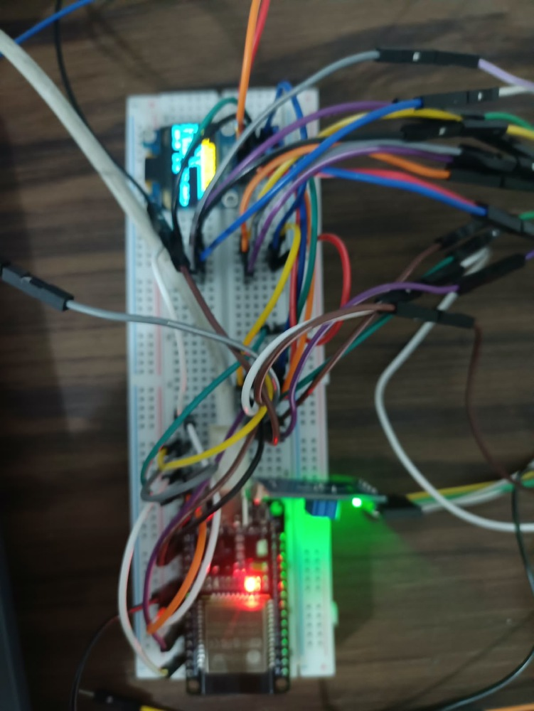
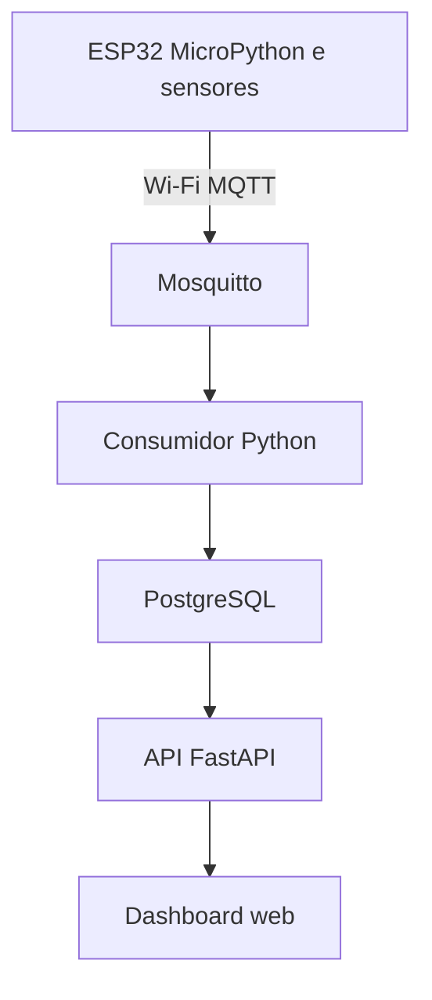
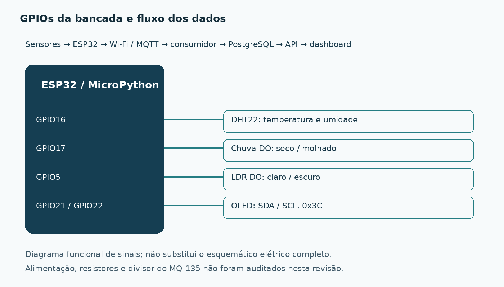
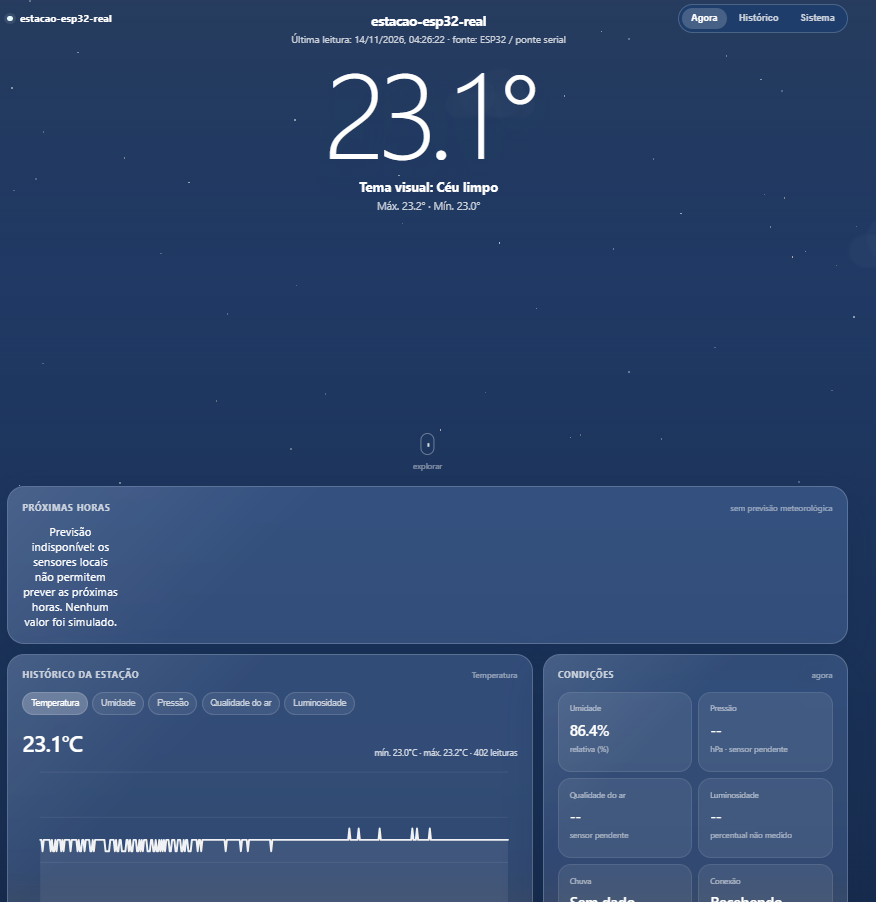
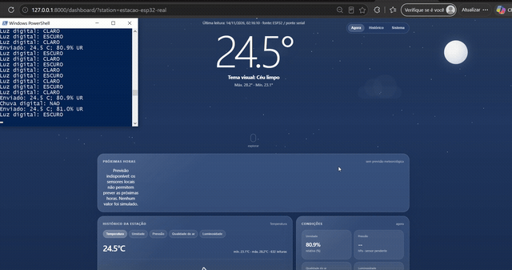

# Estação Meteorológica Inteligente com ESP32

[**Assistir ao vídeo técnico final**](https://drive.google.com/file/d/1VV7muJSFhdsuNPyCYu68f9lr4-w4Nkvk/view)

Projeto e Desenvolvimento II, Ciência da Computação, UNIP. Revisão de entrega em 21/11/2026.

## Resultado demonstrado

Em 14/11, o ESP32 executou **MicroPython** e transmitiu temperatura e umidade reais do DHT22 por **Wi-Fi/MQTT** ao Mosquitto. O consumidor Python gravou as medições no PostgreSQL; a API FastAPI alimentou o dashboard. OLED e terminal USB foram preservados. Os registros SQL mostram cinco amostras a cada dois segundos; outra captura do painel mostra 402 leituras. São instantes distintos, sem calibração metrológica ou ensaio prolongado de autonomia.

[Relatório integrado, evidências e uso de IA](https://drive.google.com/file/d/10MLNWlOfMkmOKNsusTDSSMK6bLAFs8c0/view) · [Slides e declaração da equipe](https://drive.google.com/file/d/1hS0vpax3CLZchzb4n_E1WCQakY_8jJ2u/view) · [Pacote completo de código revisado](https://drive.google.com/file/d/1vBphSf6ZJgTKzaz-CQMKEJHqsqmMuvpY/view)



## Arquitetura



O painel consulta a API; não acessa o banco diretamente. USB/ponte HTTP é um caminho alternativo de bancada. MQTT, API e banco são processos separados. As configurações de rede e senhas são locais e não fazem parte do repositório.

## Hardware disponível

| Elemento | Ligação ou situação |
|---|---|
| ESP32 DevKit | MicroPython; USB para alimentação e terminal |
| DHT22 | GPIO16; temperatura e umidade reais |
| OLED SSD1306 | SDA GPIO21, SCL GPIO22, endereço I2C 0x3C |
| Detector de chuva digital | GPIO17; presença de água; não mede mm |
| LDR digital | GPIO5; claro/escuro; não mede lux ou porcentagem |
| Módulo 280 | Sem resposta no scanner disponível; pressão OLED identificada como DEMO |
| MQ-135 | Sem montagem e calibração validadas |



Este é um diagrama funcional, não um esquemático elétrico completo. Valores de resistores, alimentação física, divisor do MQ-135 e proteção de entradas ainda exigem documentação e verificação. Não se presume que um sensor de 5 V possa ser conectado diretamente ao ESP32. GPIO5 é pino de strapping.

## Instalação no notebook

Requisitos: Python 3.12 ou compatível, PostgreSQL 16 e Mosquitto. No PowerShell, a partir da raiz do projeto:

```powershell
python -m venv .venv
.\.venv\Scripts\python.exe -m pip install -r backend/requirements.txt
```

Crie o banco `estacao_meteorologica` no PostgreSQL e aplique a migration, informando sua própria senha quando solicitada:

```powershell
& "C:\Program Files\PostgreSQL\16\bin\psql.exe" -U postgres -h localhost -d estacao_meteorologica -f database/migrations/001_schema_inicial.sql
```

### Broker MQTT de bancada

Use rede privada e confiável. Uma configuração de ensaio do Mosquitto pode conter:

```conf
listener 1884 0.0.0.0
allow_anonymous true
```

Salve-a localmente como `mosquitto-bancada.conf` e execute:

```powershell
& "C:\Program Files\mosquitto\mosquitto.exe" -c .\mosquitto-bancada.conf -v
```

Essa configuração sem autenticação/TLS serve apenas à bancada em rede confiável. Não encaminhe a porta para a internet. Autorize no firewall somente o acesso necessário pela rede privada.

### Consumidor e API

Em **cada um** dos dois terminais seguintes, configure o mesmo banco e informe a senha local sem incluí-la em arquivos versionados:

```powershell
$credencialBanco = Get-Credential -UserName postgres -Message "Senha local do PostgreSQL"
$env:PGPASSWORD = $credencialBanco.GetNetworkCredential().Password
$env:DATABASE_URL = "postgresql://postgres@localhost:5432/estacao_meteorologica"
$env:MQTT_BROKER_HOST = "127.0.0.1"
$env:MQTT_BROKER_PORT = "1884"
$env:PYTHONPATH = "backend"
```

No terminal do consumidor:

```powershell
.\.venv\Scripts\python.exe -m app.workers.mqtt_consumer
```

No terminal da API:

```powershell
.\.venv\Scripts\python.exe -m uvicorn app.main:app --host 127.0.0.1 --port 8000
```

Abra **http://127.0.0.1:8000/dashboard/?station=estacao-esp32-real**. Sem `DATABASE_URL`, o armazenamento temporário de demonstração não comprova recepção do protótipo. API e consumidor precisam compartilhar o PostgreSQL.

### ESP32 já migrado

Não apague a flash nem regrave a placa apenas para apresentar. Preserve os backups. Os módulos executáveis estão em `firmware/src/`, incluindo `board/station.py` e `services/mqtt_publisher.py`. Na placa, `wifi_profiles.json` guarda os perfis locais e `mqtt_config.json` configura o publicador. Exemplo sem credenciais reais:

```json
{"enabled":true,"host":"IPV4_DO_NOTEBOOK","port":1884,"station_id":"estacao-esp32-real"}
```

Use o **IPv4 do notebook na mesma rede**, não 127.0.0.1, como destino do ESP32. Mudança de IP exige ajustar a configuração. O relógio UTC precisa estar válido; a sincronização NTP autônoma não foi concluída. Feche leitores da COM antes de transferir arquivos. Para acompanhar sem reiniciar a aplicação: `python -m mpremote connect COM7 resume repl` após instalar as dependências de migração. A porta COM é específica de cada computador.

Para nova instalação, consulte [migração com backup](docs/integracao/migracao-micropython-bancada.md) e [publicação MQTT](docs/integracao/mqtt-bancada.md). A migração apaga a flash somente após backup; não é necessária na bancada já migrada.

## Interface e registros reais





O GIF registra a etapa USB anterior ao MQTT. A origem de cada evidência é preservada. A captura do dashboard possui um rótulo antigo de ponte serial, mesmo no registro posterior à integração MQTT; isso é uma limitação visual documentada. Temas de céu/noite/chuva são efeitos visuais, não previsão meteorológica.

## Telemetria e qualidade

Tópico: `estacao/<station_id>/telemetry`. Contrato: [JSON v1.0](docs/contratos/telemetria-v1.0.json). O payload contém `station_id`, `timestamp`, `location`, `measurements` e `quality`. Métricas sem leitura válida permanecem `null`; pressão DEMO não é publicada como pressão real. A publicação é MQTT 3.1.1 QoS 0; não equivale a entrega garantida ou fila offline.

## Testes e limitações

| Caso | Situação documentada |
|---|---|
| CT01: variação térmica do DHT22 | Parcial; leituras reais, sem ensaio controlado formal completo |
| CT02: queda e reconexão Wi-Fi | Não aprovado integralmente; recuperação exigiu intervenção |
| CT03: temperatura 150 °C | Rejeitada pela API em teste de software |
| CT04: coordenadas no mapa | Não implementado |

Revisão local de 21/11: **31 testes de firmware, 32 de backend e 12 de frontend aprovados**; dois testes de integração com infraestrutura externa não foram executados localmente. Testes em computador não substituem ensaios físicos. Consulte os checks do PR para a execução com broker e banco no CI.

```powershell
$env:PYTHONPATH="firmware/src"
.\.venv\Scripts\python.exe -m pytest firmware/tests -q
$env:PYTHONPATH="backend"
.\.venv\Scripts\python.exe -m pytest backend/tests -q
.\.venv\Scripts\python.exe -m pytest frontend/tests -q
.\.venv\Scripts\python.exe scripts/validate_contract.py
```

Continuam incompletos: pressão real, MQ-135, báscula/debounce, luminosidade quantitativa, mapa, alertas extremos, filtros temporais/média móvel, latência física formal e autonomia. Consulta de 2 s não comprova latência ponta a ponta máxima de 5 s. O projeto não é instrumento meteorológico certificado. As adaptações por orçamento não significam atendimento integral dos requisitos.

## Documentação e autoria

- [Arquitetura](docs/arquitetura/arquitetura-sistema.md)
- [Modelo e migrations](database/migrations/001_schema_inicial.sql)
- [Requisitos e rastreabilidade](docs/requisitos/matriz-rastreabilidade-n2.md)
- [Montagem histórica DEV 1.1](hardware/registro-montagem-dev-1.1.md)
- [N1 histórica](docs/academico/n1/relatorio-n1.md)
- [Contribuição](CONTRIBUTING.md)

Enthony Guilherme Silva: hardware; James dos Anjos Pereira Santos: apresentação/documentação; Luan Vinicius Medina Lemos: software; Luiz Manoel de Oliveira Souza: dashboard. A declaração de uso de IA está no relatório integrado. Textos datados de fases anteriores são registros históricos; esta revisão identifica o estágio demonstrado e seus limites.
